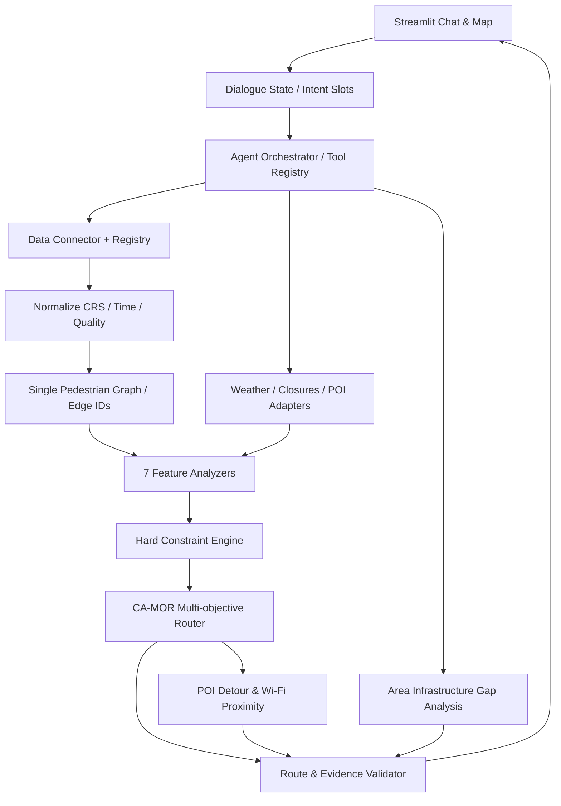

# JEJU LifePath AI — 시스템 아키텍처 및 상세 기술 설계
Version: 3.1 · 2026-11-01 · 요구사항: [REQUIREMENTS.md](REQUIREMENTS.md)

## 1. 아키텍처 결정
단일 Python 기반 Agent Orchestrator + 하나의 그래프 라우터. 7종 분석기는 edge features 생산자이고, POI/Wi-Fi는 같은 그래프를 재사용한다. LLM은 수치 계산을 하지 않는다.



## 2. 책임 분리
- **Data**: 원본 확보, 출처/기준일/라이선스 관리, 정제, 좌표계/시간 통일, 체크섬.
- **Graph**: OSMnx/NetworkX 방향성 보행로, edge_id 부여, 연결성 검증, route snap.
- **Feature**: CCTV/조명/범죄 맥락/유동인구/보행사고/기상/접근성 feature 계산; 각 값에는 품질과 출처.
- **Constraints**: 통제 + 사용자별 이동제약. BLOCK 제외, UNKNOWN 보수적 처리.
- **Routing**: 제약 통과 그래프에서 기준 경로, 복합 경로, 후보·우회 한도 분석.
- **POI**: POI 유형별 공통 검색·최소 경유 비용·Wi-Fi AP 접근성.
- **Gap**: 구역별 POI 접근성과 시설 커버리지, 누락·집계단위 명시.
- **Agent**: 의도 파악, 필요한 슬롯만 질문, tool calling, 대화상태 및 사용자 선호 관리.
- **Validation**: route graph connectivity, closures, access, detour, quality, provenance, evidence assertions.
- **UI**: 채팅, 선택 버튼, 지도, 경로 비교, 데이터 한계, 시각화.

## 3. 디렉터리 제안
```text
jeju_agent/
  README.md
  pyproject.toml
  .env.example
  docs/
    REQUIREMENTS.md
    ARCHITECTURE.md
    DATA_SOURCES.md
    WEIGHT_EVIDENCE.md
    VALIDATION.md
    USER_MANUAL.md
  src/jeju_lifepath/
    app.py
    agent/{orchestrator.py,dialogue.py,tools.py}
    data/{registry.py,connectors.py,normalize.py}
    geo/{graph.py,snap.py,features.py}
    routing/{constraints.py,cost.py,optimizer.py,alternatives.py}
    poi/{search.py,detour.py}
    analytics/{gap.py,weights.py}
    schemas/{edge.py,request.py,result.py}
    validation/{route.py,evidence.py}
  tests/{unit,integration,fixtures}/
```
구조는 기존 코드 조사 후 필요하면 조정하며 강제 재작성 금지.

## 4. 형식 계약
```python
class RouteRequest:
    origin: tuple[float, float] | str
    destination: tuple[float, float] | str
    departure_time: str | None
    route_preference: str  # SHORTEST/SAFETY/BALANCED
    mobility_profile: str
    avoid_stairs: bool
    detour_ratio: float   # 0~0.50 initial policy
    poi_categories: list[str]
    require_verified_accessibility: bool

class RouteResult:
    status: str  # OK/UNVERIFIED/NO_FEASIBLE_ROUTE/DATA_UNAVAILABLE
    route_edge_ids: list[str]
    length_m: float | None
    estimated_minutes: float | None
    indicator_breakdown: dict
    coverage: dict
    provenance: list[str]
    caveats: list[str]
```
실제 구현은 Pydantic schemas를 권장하고 필드 정의는 REQUIREMENTS와 일치시킨다.

## 5. 비용 및 제약
- Edge features는 [0,1] 정규화하되 unavailable은 null. 유동인구는 고립회피와 혼잡회피를 분리. 범죄 통계의 공간해상도가 낮으면 골목 위험도 예측 금지.
- PASS/BLOCK/UNKNOWN 사용. BLOCK 경로 절대 금지. 이동약자 검증 경로는 PASS-only. 갱신 실패는 'OPEN' 추정 금지.
- 비용 `cost(e,u,t)=length_m*(1+lambda_u*q_e)`, `q_e=sum(w_i*r_i)/sum(available w_i)`. 단, 누락으로 feature coverage가 낮아지면 별도 불확실성 경고, 중요한 제약은 단순 재정규화로 무시하지 않음.
- `route_length <= shortest_feasible_length*(1+detour_ratio)`. 후보 경로 탐색 후 길이 상한 재검증; 완전 최적해를 주장하려면 constrained shortest path에 맞는 구현과 증거 필요.
- 경로 2~3개가 중복되면 중복을 그대로 명시하며 가짜 대안 생성 금지.

## 6. 연구 기반 가중치
연구의 CCTV/가로등 설치 효과는 관련 변수 선택에만 초기 사용. 13%·14% 수치는 경로 비용의 직접 가중치가 아니다. 제주 범죄건수의 지역/기간/유형과 노출량이 충분한 경우에 한해 회귀분석 및 공간·시간 holdout 적용. 불충분하면 잠정 지표 가중치와 sensitivity analysis 제공. 가중치 설정 버전과 provenance 필수.

## 7. Agent 대화 상태기계
```text
PARSE_INTENT -> MERGE_PRIOR_SLOTS -> CHECK_MISSING
  missing destination/origin -> ASK_REQUIRED_SLOT
  missing route preference for ROUTE -> ASK_SHORTEST_SAFETY_BALANCED
  ready -> CALL_TOOLS -> VALIDATE -> EXPLAIN -> WAIT_FOLLOWUP
FOLLOWUP -> MERGE_ONLY_CHANGED_SLOTS -> CALL_TOOLS
```
실명/민감한 사용자 특성 유추 금지; 사용자가 지정한 이동조건만 적용. '안전환경'은 시설지표와 보행환경의 대리변수이지 절대안전 보증 아님.

## 8. 함수/도구 계약
```text
resolve_place(query) -> coordinate | ambiguity
get_network(bbox, graph_version) -> Graph
get_edge_features(edge_ids, time) -> features+provenance
get_closures(time, coverage) -> status+source
filter_edges(graph, profile, closures) -> valid_graph+unknowns
calculate_route(request, weights_version) -> RouteResult
search_pois(type, location, time) -> POI[]+freshness
route_via_poi(request, poi) -> RouteResult
analyze_gap(area, indicator) -> AreaGapResult
validate_result(result) -> issues[]
```
모든 tool 결과에는 데이터 소스, 관측시점, 오류/불확실성을 포함.

## 9. 시험 전략
1. Toy graph 4~8 edges에서 BLOCK 제외, PASS/UNKNOWN 규정, baseline 최단경로 재현.
2. 길이 상한 위반 0, 출발-도착 연속성, 단위(m vs km), CRS 오차 체크.
3. 누락·오래된 데이터·동일 지표 충돌·인과 오해 방지 회귀 테스트.
4. 사용자 후속 요청 시 슬롯 보존; 불필요한 재질문 방지.
5. POI 경유 거리 네트워크 기반 계산; Wi-Fi 연결지속성 보증 방지.
6. 제주 지역 실데이터 1종 이상 end-to-end 통과한 증거와 fixture 분리.
7. pytest/ruff, 외부 API 없는 제한 모드, CPU 실행, Windows 또는 센터 배포 환경 검증.
8. 결과에 '실측/추정/미확인', 출처, 갱신일 및 기능 제한 표시.

## 10. 개발 게이트
G0 schema+toy graph; G1 official data verification; G2 graph; G3 feature adapters; G4 weight governance; G5 constraints; G6 CA-MOR; G7 POI/Wi-Fi; G8 gap; G9 agent; G10 UI; G11 tests; G12 packaging.

각 게이트는 테스트 결과와 미해결 위험을 문서화하며, G1을 통과하지 못한 경우 공식 제주 데이터 적용을 주장하지 않는다. 설치키 및 개인위치 데이터 커밋 금지.

## 11. 설계 참고
https://www.jejudatahub.net/ · https://www.data.go.kr/ · https://osmnx.readthedocs.io/ · https://doi.org/10.1111/1745-9133.12419 · https://doi.org/10.1111/1745-9133.12585
