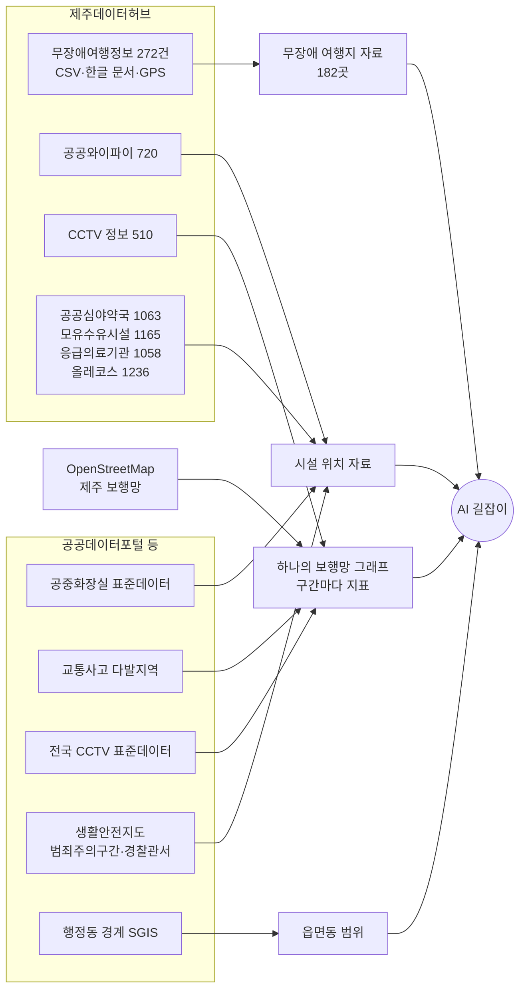
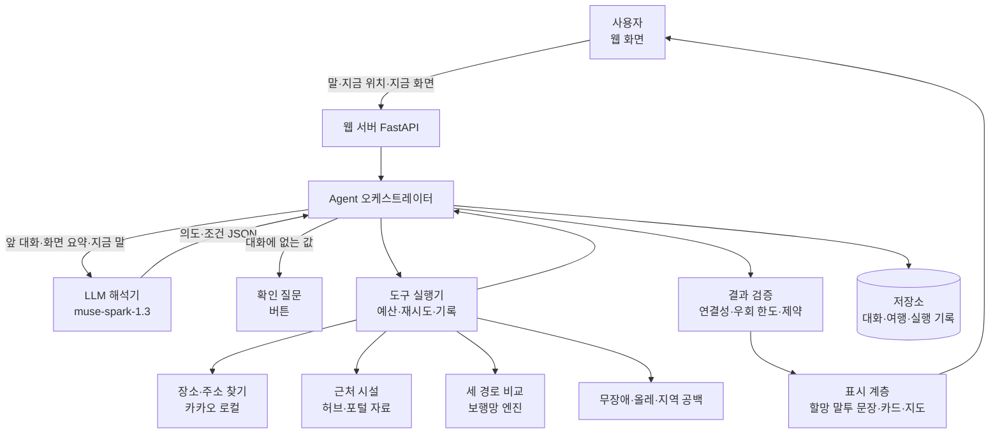
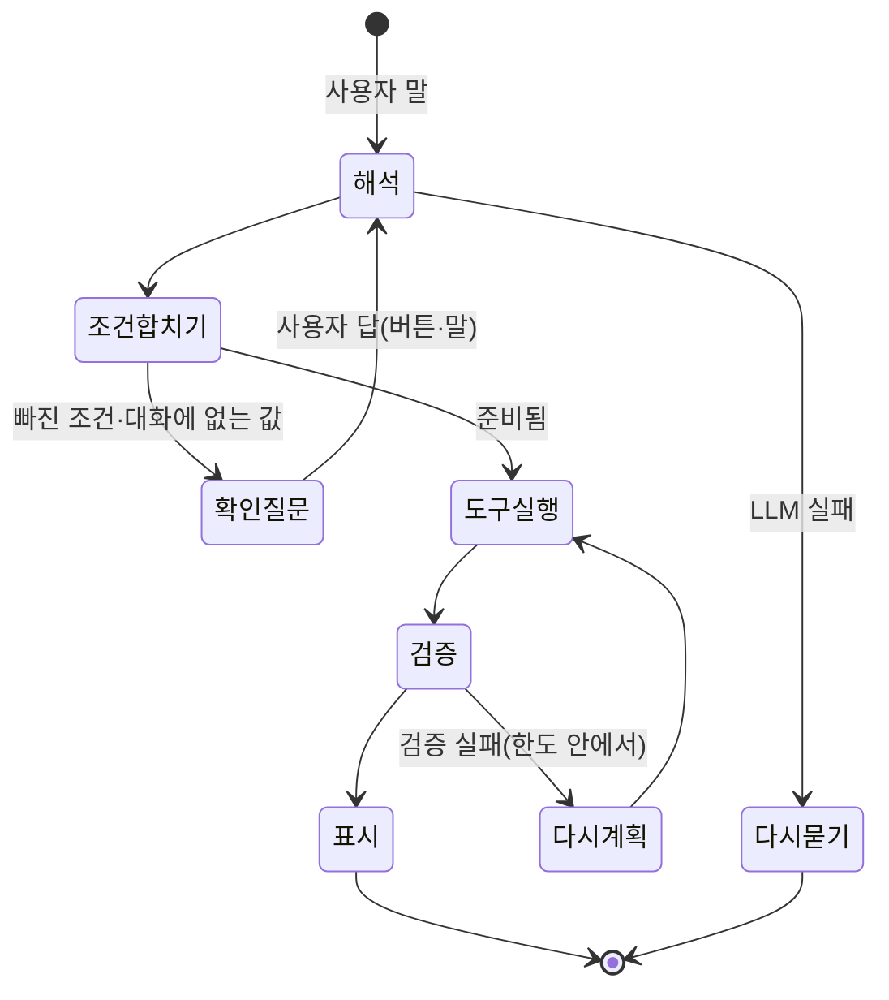

# AI Agent 기획서 — 설문대할망 AI 길잡이 (JEJU LifePath AI)

> 제주데이터허브 자료로 걷는 여행자와 주민에게 "걸어서 갈 수 있는 길·쉴 곳·도움받을 곳"을 대화 한 번으로 찾아 주는 AI Agent

작성일 2026-11-19 · 저장소 상대 경로 기준 · 상세 근거 문서는 각 절 끝에 적음

---

## 1. 기획 동기 (배경)

제주는 걷는 여행지예요. 올레길, 오름, 시장, 해안 마을을 걸어서 다니는 여행자가 많아요. 그런데 걷는 사람에게 필요한 정보는 흩어져 있어요.

- **길:** 지도 앱의 도보 길찾기는 "가장 짧은 길" 하나만 줘요. 유모차로 계단을 피하고 싶거나, 큰 차도·사고 다발 구역을 덜 지나고 싶어도 고를 수 없어요.
- **쉴 곳·도움받을 곳:** 공중화장실, 밤에 문 연 약국, 수유실, 응급실, 공공와이파이 정보는 제주데이터허브·공공데이터포털에 있어요. 하지만 엑셀·링크로 흩어져 있어 걷다가 바로 찾기 어려워요.
- **이동 약자:** 휠체어·유모차·어르신이 갈 만한 곳(무장애 여행지)은 제주도가 직접 걸어서 조사한 자료가 허브에 272건 있어요. 그런데 한글 문서와 압축 파일 속에 묻혀 있어 거의 쓰이지 않아요.
- **일정:** "동문시장에서 빵집 두 곳이랑 카페 들르고 6시까지 돌아오는 코스"처럼 말하면, 사람은 지도 여러 개를 오가며 직접 짜야 해요.

**기획 의도:** 흩어진 제주 공공데이터를 하나의 걷는 길 그래프와 하나의 대화 창구로 묶어요. 사용자는 평소 말하듯 묻기만 하면 돼요. 제주를 만든 거인 **설문대할망** 캐릭터가 다정한 할망 말투로 길을 안내해요.

---

## 2. 구현 목표

### 2-1. 분석 주제

**"걷는 사람 기준의 제주 생활·여행 접근성 분석과 대화형 안내"**

| 분석 질문 | 쓰는 데이터 | 결과 |
|---|---|---|
| 지금 여기서 걸어서 갈 만한 화장실·약국·수유실·응급실·와이파이는? | 허브 공공와이파이·심야약국·수유시설·응급의료기관, 공중화장실 표준데이터 | 거리순 목록, 지도 표시 |
| A에서 B까지 걷는 길 중 짧은 길·덜 위험한 길·그 중간은? | OSM 제주 보행망, 교통사고 다발지역 | 세 경로 비교(거리·시간·지나는 위험 구역) |
| 가는 길에 덜 돌아가며 들를 곳은? | 보행망 + 장소 | 우회 거리순 후보 |
| 우리 동네에서 시설까지 걸어서 멀리 떨어진 곳은? | 행정동 경계 + 보행망 + 시설 | 읍면동별 "가장 가까운 시설까지 걷는 시간" |
| 휠체어·유모차로 갈 만한 곳과 그 안의 코스는? | 허브 무장애여행정보(CSV·한글 문서·GPS 기록) | 접근성 요약, 주의 지점, 실제로 걸은 코스 선 |
| 올레길 몇 코스가 가까운가? | 허브 올레코스현황 | 코스 정보, 가까운 시작점 |

### 2-2. AI를 활용한 데이터 분석 목표

1. **말을 분석 조건으로 바꾸기:** LLM이 사용자의 말과 앞 대화, 지금 보는 화면을 읽고 의도와 조건(출발·도착, 들를 곳 종류·개수, 시각, 이동 조건, 경로 유형)을 뽑아요.
2. **계산은 검증된 도구가:** 거리·시간·경로·우회 계산은 LLM이 하지 않아요. 보행망 그래프 엔진과 데이터 도구가 계산해요. LLM이 숫자를 지어낼 길을 구조적으로 막았어요.
3. **비정형 공공자료를 쓸 수 있는 자료로:** 허브의 한글(HWP) 문서 70개와 압축 파일 51개를 직접 읽었어요. 장애인 화장실·주차, 경사·계단 설명, GPS 경로를 뽑아 182곳의 무장애 여행지 자료로 만들었어요.
4. **근거와 한계를 함께:** 모든 답에 자료 출처와 기준 시점을 붙여요. "영업 여부 미확인", "2019~2021년 조사 자료" 같은 한계도 함께 보여 줘요.

---

## 3. 문제점 · 해결 방안 · 솔루션

| # | 문제점 | 해결 방안 | 솔루션(구현된 기능) |
|---|---|---|---|
| 1 | 도보 길찾기가 최단 경로 하나뿐이라 조건을 고를 수 없음 | 같은 보행망에서 목적이 다른 경로를 함께 계산해 비교 | **세 경로 비교:** 최단·균형·안전환경 우선. 사고 다발 구역 통과, 계단(유모차) 제외, 공개 CCTV 근처 선호(사용자가 원할 때). 휠체어·유모차는 계단·휠체어 불가 길을 피하고 확인 안 된 길 비율을 알림 |
| 2 | 화장실·심야약국·수유실·응급실 정보가 흩어져 있음 | 허브·포털 자료를 한 도구로 묶어 지금 위치 기준으로 검색 | **근처 시설 찾기:** "근처 화장실", "밤에 문 연 약국", "수유실", "응급실"(항상 119 안내 함께). 밤늦게 그냥 "약국"을 찾으면 공공심야약국을 찾을지 먼저 물음 |
| 3 | 무장애 여행 자료가 한글 문서·압축 파일에 묻혀 있음 | HWP 본문 읽기와 GPS CSV 묶기로 장소별 접근성 자료 생성 | **무장애 여행지:** 가까운 5곳, 장소별 장애인 화장실·휠체어 추천·주의 지점, 조사자가 걸은 코스를 지도에 초록 선으로. 이동이 불편한 사람의 여행지 추천은 무장애 여행지 위주. 조사 코스는 휠체어 길찾기의 확인된 길로도 씀 |
| 4 | 여러 곳을 들르는 걷기 일정은 사람이 직접 짜야 함 | LLM이 조건을 뽑고, 엔진이 실제 걷는 시간으로 순서·도착 시각 계산 | **대화로 일정 만들기·고치기:** "카페 빼줘", "두 번째 곳 먼저" 같은 말로 수정. 여러 날 일정도 지원. AI 일정은 초안이고, 저장은 사용자가 버튼으로. 휠체어·유모차·몸이 불편하면 무장애 여행지로 일정을 짜고 카드에 접근성 요약 |
| 5 | 동네별 시설 공백을 주민이 알기 어려움 | 읍면동 안의 길마다 가장 가까운 시설까지 걷는 시간 계산 | **지역 공백 보기:** "이도2동 약국 먼 곳"이라고 물으면 절반 지점·가장 먼 곳까지 걷는 시간 |
| 6 | 범죄 위험 정보는 낙인 우려가 있고 해석이 어려움 | 원본 지도를 그대로 겹쳐 보여주고, 점수로 바꾸지 않음 | **범죄주의구간 겹쳐 보기:** 생활안전지도 원본. "지금 위험하다는 뜻이 아니에요" 안내. 원하는 지점을 찍어 그곳을 지나는 길로 다시 계산 |
| 7 | AI가 그럴듯하게 지어낼 위험 | 계산은 도구가, 대화에 없는 장소 이름·조건은 실행 전에 확인 | "성산일출봉 말하는 거니?", "유모차 쓰는 길로 찾아줄까?"처럼 먼저 묻기. 몸이 불편하다고만 하면 "휠체어나 유모차를 쓰니?". LLM이 실패하면 억지로 해석하지 않고 다시 말해 달라고 함. 내부 값·확인 안 된 사실은 화면에 내지 않음 |
| 8 | 외부 지도 서비스 정책 위반 위험 | 카카오 결과를 저장하지 않고 외부 LLM에도 보내지 않도록 설계 | 장소 이름·주소·좌표는 요청할 때만 쓰고 저장본에서 뺌(자동 테스트로 확인) |

---

## 4. 서비스 제안

### 4-1. 데이터 활용 개요

### 4-2. 핵심 기능

| 기능 | 이렇게 물으면 | 결과 |
|---|---|---|
| 근처 시설 | "여기 근처 화장실 어디야?" | 거리순 카드, 지도 표시. 밤에 "근처 약국"이면 "공공심야약국을 찾아 줄까?" [심야약국 찾아줘] 버튼 |
| 길찾기(세 경로) | "제주시청에서 동문시장까지 걸어서" | 최단·균형·안전환경 우선 경로 카드와 지도 선, 각 경로의 시간·지나는 위험 구역. "휠체어로"라고 하면 계단을 피한 길과 확인 안 된 길 비율 |
| 가는 길에 들르기 | "공항에서 동문시장 가는 길에 약국" | 덜 돌아가는 순서로 최대 6곳 |
| 걷기 일정 | "동문시장에서 빵집 두 곳이랑 카페 들르고 6시까지 돌아오는 코스" | 순서·도착 시각·걷는 시간이 들어간 일정 초안, 지도 |
| 무장애 여행지 일정 | "휠체어 타는 엄마랑 갈 만한 곳 세 곳 들르고 돌아오는 코스" | 무장애 여행지로 짠 일정, 장소마다 장애인 화장실·주의 지점 수 |
| 일정 고치기 | "두 번째 곳 빼줘", "카페 말고 빵집" | 고친 초안(원래 여행은 그대로) |
| 무장애 여행지 | "한림공원 휠체어로 갈 수 있어?" | 장애인 화장실·주차, 주의 문장, 지점 카드, 걸은 코스 선. "몸 불편한 엄마랑 갈 만한 곳"은 무장애 여행지 위주 추천 |
| 올레길 | "올레 7코스 알려줘", "가까운 올레" | 코스명·거리·소요시간·시작·끝 |
| 지역 공백 | "이도2동 약국 먼 곳" | 읍면동 안에서 시설까지 걷는 시간 |
| 범죄주의구간 | 지도 버튼 | 원본 지도 겹치기(많이 확대하면 숨김) |

### 4-3. 편의성

- **말 한 번으로:** 메뉴를 찾지 않고 평소 말투로 물어요. 앞 대화를 기억해서 "거기", "아까 두 번째"도 알아들어요.
- **꼭 필요할 때만 질문:** 경로 유형처럼 결과가 달라지는 것만 물어요. 대답은 버튼으로 할 수 있어요.
- **지금 보는 화면을 앎:** 플래너에서 AI 버튼을 누르면 그 여행을 보면서 이야기해요.
- **초안과 저장 분리:** AI가 만든 일정은 초안이에요. "내 여행에 저장"을 눌러야 저장돼서 원래 여행이 몰래 바뀌지 않아요.
- **대화 관리:** 새 대화, 지난 대화 불러오기, 제목 바꾸기, 기록 지우기를 지원해요. 기록은 7일 뒤 저절로 지워져요.
- **기사님께 보여주기:** 목적지를 큰 글씨로 보여 줘서 택시·버스를 탈 때 쓸 수 있어요.
- **쉬운 말:** 화면에 영어 코드·내부 번호·전문 용어를 내지 않아요(자동 테스트로 검사).

### 4-4. 분석 데이터 활용 방안

| 누가 | 어떻게 쓰나 |
|---|---|
| 여행자 | 걷는 길·쉴 곳·도움받을 곳을 한 번에 찾음 |
| 이동 약자와 가족 | 무장애 여행지와 계단 없는 길(유모차)로 미리 계획 |
| 제주도·제주빅데이터센터 | 읍면동별 시설 공백 결과로 화장실·수유실·심야약국 배치 검토. 무장애 조사 자료를 실제 서비스에서 활용하는 사례 |
| 주민 | 우리 동네 시설까지 걷는 시간 확인 |

---

## 5. 아키텍처

### 5-1. 서비스 아키텍처 (사용자가 만나는 흐름)

### 5-2. 솔루션 아키텍처 (구성 요소와 기술)

| 층 | 구성 | 기술 |
|---|---|---|
| 화면 | 로그인, AI 길잡이(대화+지도), 내 여행, 플래너, 여행 안내 | React 19, Vite, 카카오맵 지도 JS API |
| 서버 | REST API, 대화·실행·취소·재개, 여행 저장 | Python 3.12, FastAPI, uvicorn |
| Agent | 해석(LLM) → 조건 합치기 → 확인 질문 → 도구 실행 → 검증 → 표시 | 직접 구현(오케스트레이터, ToolRunner, presenter) |
| 경로 엔진 | 하나의 보행망 그래프, 구간마다 지표, 세 경로 계산, 우회 한도 검증 | NetworkX, Shapely, pyproj |
| 데이터 처리 | CSV·HWP·압축 파일 읽기, 좌표 정규화, 무장애 자료 묶기 | Python 표준 라이브러리, olefile |
| 저장소 | 대화·여행·실행 기록, 7일 보유 | SQLite |
| 평가 | 도구 호출·품질·공격 평가 | agentevals, DeepEval, openevals, promptfoo |

설계 원칙:
- **LLM은 해석만, 계산은 도구가:** 거리·시간·경로 숫자는 모두 엔진에서 나와요.
- **내부 결과와 사용자 문장 분리:** 도구는 구조화된 값을 돌려주고, 표시 계층이 쉬운 문장·카드·지도로 바꿔요.
- **하나의 그래프:** 모든 경로·우회·공백 계산이 같은 보행망과 같은 구간 지표를 써요.

---

## 6. Agent 개발 구성

### 6-1. 참여자의 역할·목표·Workflow

| 참여자 | 역할 | 목표 |
|---|---|---|
| 사용자 | 말로 요청, 확인 질문에 답, 초안 저장 결정 | 원하는 길·장소·일정을 얻음 |
| LLM 해석기 | 말 → 의도·조건(JSON). 잡담·도움말 답 | 사용자의 뜻을 정확히 파악 |
| 오케스트레이터 | 앞 조건 합치기, 질문 결정, 도구 순서 결정, 예산 관리 | 필요한 것만 묻고 필요한 도구만 부름 |
| 도구 | 장소 찾기, 시설 찾기, 경로 비교, 들를 곳, 지역 공백, 무장애, 올레, 이동 시간표 | 검증 가능한 계산 결과 |
| 검증기 | 경로 연결성, 우회 한도, 이동 제약(계단 등), 고정·다녀온 곳 유지 확인 | 틀린 결과를 내보내지 않음 |
| 표시 계층 | 할망 말투 문장, 카드, 지도, 한계 안내 | 쉬운 말, 내부 값 노출 0 |

### 6-2. 사용 모델

| 용도 | 모델 | 설정 |
|---|---|---|
| 요청 해석(서비스) | Meta **muse-spark-1.3** (Meta Model API, OpenAI 호환) | reasoning_effort=low, 제한 시간 20초, 실행당 최대 2회 |
| 평가 채점 | OpenAI Codex CLI | 에이전트와 다른 모델로 채점(자기 채점 방지) |
| 개발 보조 | Anthropic Claude Code(코드 작성·검토), OpenAI Codex(비판 검토) | 사람이 결정하고 확인 |
| 캐릭터 그림 | Google Gemini | 설문대할망 캐릭터 이미지 |

LLM이 없어도 시험할 수 있도록 규칙 해석 모드(개발·테스트용)를 두었어요.

### 6-3. Tool / API

| 도구 | 하는 일 | 데이터·API |
|---|---|---|
| `resolve_location` | 장소 이름·주소 → 위치(후보가 여럿이면 고르게 함) | 카카오 로컬 API |
| `search_places` | 장소 종류 검색(빵집·카페 등) | 카카오 로컬 API |
| `find_nearby_facilities` | 근처 화장실·약국·와이파이·파출소·심야약국·수유실·응급실 | 허브 720·1063·1165·1058, 공중화장실 표준, 생활안전지도 경찰관서, 카카오 |
| `compare_routes` | 최단·균형·안전환경 세 경로 | OSM 보행망 + 교통사고 다발지역 + CCTV |
| `find_route_stops` | 가는 길에 덜 돌아가는 들를 곳 | 보행망 |
| `get_travel_matrix` | 일정용 장소 간 걷는 시간표 | 보행망 |
| `analyze_area_access` | 읍면동 안 시설까지 걷는 시간 | 행정동 경계 + 보행망 |
| `barrier_free_places` | 무장애 여행지(가까운 곳·장소 상세·코스 선) | 허브 무장애여행정보 |
| `olle_courses` | 올레 코스 안내·가까운 코스 | 허브 1236 |

모든 도구는 정해진 입력 형식(Pydantic)으로 검사하고, 시간 제한·재시도(최대 2번)·호출 기록을 둬요.

### 6-4. 판단 및 자율 수행 범위

| Agent가 스스로 하는 것 | 사용자에게 묻거나 맡기는 것 | 하지 않는 것 |
|---|---|---|
| 의도·조건 파악, 도구 순서 결정 | 경로 유형(처음 한 번) | 차·버스·택시 경로, 예약·결제 |
| 장소 후보가 하나면 바로 사용 | 장소 후보가 여럿이면 고르기 | 영업 여부·날씨·혼잡 단정 |
| 경로·일정 계산, 검증 실패 시 다시 계획(한도 안) | 대화에 없는 장소 이름(오타를 고친 것 등) 확인 | 나이·몸 상태로 이동 조건 짐작 |
| 일정 초안 만들기·고치기 | 초안을 내 여행에 저장, 덮어쓰기 여부 | 다른 사용자의 정보 보기·바꾸기 |
| 실패 시 재시도 2번, 41초를 넘으면 멈추고 부분 결과 안내 | 돌려 말한 휠체어·유모차 조건 확인, 몸이 불편할 때 휠체어·유모차 여부 | 카카오 결과 저장·외부 LLM 전송 |

---

## 7. 데이터 활용 계획

### 7-1. 필수 데이터 (제주데이터허브)

| 허브 번호 | 데이터명 | 활용 항목 | 쓰는 곳 |
|---|---|---|---|
| 무장애 검색 272건 | 무장애여행정보(통합), 무장애여행위치정보, 무장애여행일반정보(한글 문서), 데이터셋(압축 파일) | 장소명·주소·위경도, 코스 지점(순서·위경도·구분·설명), GPS 경로(위경도·고도), 장애인 주차·화장실, 추천 대상, 경사·계단 설명, 관람시간 | 무장애 여행지 |
| 720 | 공공와이파이 AP 정보 | 설치 장소명·위경도 | 근처 와이파이 |
| 510 | CCTV 정보 | 설치 위치·목적 | 안전환경 경로(공개 CCTV 근처 선호) |
| 1063 | 제주특별자치도_공공심야약국현황 | 약국명, 소재지, 운영종료시간, 운영요일 | 밤에 문 연 약국 |
| 1165 | 제주특별자치도_모유수유시설설치현황 | 설치장소, 주소, 용도 | 수유실 |
| 1058 | 제주특별자치도_응급의료기관현황 | 구분, 의료기관, 소재지, 전화번호 | 응급실(119 안내 함께) |
| 1236 | 제주특별자치도_올레코스현황 | 코스, 코스명, 거리, 소요시간, 시종점 | 올레 안내 |

### 7-2. 보조 데이터 (외부, 적법 사용)

| 데이터 | 출처 | 활용 | 이용조건 |
|---|---|---|---|
| 제주 보행망 | OpenStreetMap | 걷는 길 그래프 | ODbL(출처 표시) |
| 공중화장실 표준데이터(제주 849곳) | 공공데이터포털 | 근처 화장실, 지역 공백 | 공공데이터포털 이용허락 |
| 교통사고 다발지역 | 한국도로교통공단, 전국교통사고다발지역표준데이터(보행노인·보행어린이 등) | 안전환경 경로에서 덜 지나기 | 공공데이터포털 이용허락 |
| 전국 CCTV 표준데이터(제주 1,043곳) | 행정안전부(공공데이터포털) | 안전환경 경로 보조 | 공공데이터포털 이용허락 |
| 범죄주의구간(WMS), 경찰관서 | 생활안전지도 | 원본 지도 겹쳐 보기, 근처 파출소 | 포털 "제한 없음" / 생활안전지도 공공누리 4유형(변경 금지) → 원본 그대로 보여주기만 함 |
| 행정동 경계 | 통계청 SGIS(가공: vuski/admdongkor) | 지역 공백의 읍면동 범위 | CC BY 4.0(출처 표시) |
| 지도·장소 검색 | 카카오맵 JS API, 카카오 로컬 API | 화면 지도, 장소·주소 → 위치 | 카카오 운영정책: 결과 저장 금지·외부 LLM 전송 금지를 지킴 |

### 7-3. 수집·전처리 방법

| 자료 | 수집 | 전처리 |
|---|---|---|
| 무장애 CSV 171개 | 허브 로그인 후 내려받기(받은 목록은 `data/specs/barrier_free_hub_manifest.csv`) | 문자 인코딩 판별, 장소 이름 기준으로 묶기(띄어쓰기·기호 무시) |
| 무장애 한글 문서 70개 | 허브 첨부 | HWP 5 문서 구조에서 본문만 읽음(`src/backend/jeju_lifepath/data/hwp.py`). 두 가지 문서 틀에서 항목 뽑기 |
| 무장애 압축 파일 51개 | 허브 첨부 | CSV만 꺼냄. GPS 경로는 최대 300점으로 줄이고, 지점 설명에서 계단·경사·턱 주의 문장 표시 |
| 결과 | `scripts/build_barrier_free.py` | 182곳(문서 설명 62곳, GPS 코스 50곳, 지점 4,579개) |
| 허브 LINK 자료 4종 | `scripts/fetch_hub_links.py` | 주소만 있어 요청할 때 카카오 주소 검색으로 위치를 구하고 저장하지 않음 |
| OSM 보행망 | 제주 범위 추출 | 걸을 수 있는 길만 남기고 구간마다 고유 번호 부여, 연결성 검사 |
| 사고 다발지역 | `scripts/fetch_accident_zones.py` | 제주만 골라 영역 도형으로 저장, 보행망 구간에 겹침 표시 |
| 행정동 경계 | `scripts/fetch_admdong.py` | 원본 해시 확인 후 제주 43개 읍면동만 저장 |

원본·가공 자료는 `data/private/`, `data/processed/`에 두고 저장소에는 올리지 않아요. 받는 방법은 스크립트와 문서로 재현할 수 있어요.

### 7-4. 이용조건 지키는 방법

- 자료마다 출처와 기준 시점을 답에 함께 보여요.
- 카카오 결과(장소 이름·주소·좌표)는 저장소·대화 기록·외부 LLM 어디에도 남기지 않아요. 자동 테스트(`test_kakao_results_not_stored`)로 확인해요.
- 범죄주의구간은 원본 그림을 바꾸지 않고 겹치기만 해요. 점수로 바꾸지 않아요.
- API 키는 `.env`에만 두고 제출물에 넣지 않아요. 평가용 LLM 키만 대회 규칙에 따라 사용 한도를 걸어 따로 제공해요.

상세: `docs/DATA_AVAILABILITY.md` §10~13

---

## 8. 개발·탑재 계획

### 8-1. 구현 범위 (2026-11-19 현재 구현 완료)

- AI 길잡이 대화 화면(대화+지도), 새 대화·지난 대화·제목 바꾸기·기록 삭제
- 근처 시설 7종, 세 경로 비교, 가는 길에 들르기, 걷기 일정 만들기·고치기(여러 날 포함), 내 여행 저장
- 무장애 여행지(이동 약자 추천), 휠체어 길찾기(확인 안 된 길 비율 경고), 올레 코스, 지역 공백, 범죄주의구간 겹쳐 보기
- 대화에 없는 값 확인 질문, LLM 실패 시 다시 묻기, 서버 재시작 후 실행 이어가기, 취소
- 자동 테스트 394개, 오픈소스 평가 4종

### 8-2. 기술 환경

| 구분 | 내용 |
|---|---|
| 언어·실행 | Python 3.12 이상(서버), Node.js(화면 빌드만) |
| 주요 라이브러리 | FastAPI 0.163.1, Pydantic 2.14.2, NetworkX 3.7, Shapely 2.2.0, pyproj 3.8.0, olefile 0.47 / React 19, Vite 8 |
| 버전 고정 | `pyproject.toml`, `uv.lock`, `package-lock.json` |
| GPU | 쓰지 않음(LLM은 외부 API) |

### 8-3. UI 구성

| 화면 | 내용 |
|---|---|
| 로그인 | 설문대할망 캐릭터 환영 |
| AI 길잡이(첫 화면) | 넓은 화면: 왼쪽 대화·오른쪽 지도 / 폰: 위 지도·아래 대화. 경로 카드, 장소 카드, 확인 버튼, 일정 초안과 저장 버튼 |
| 내 여행 | 저장한 여행 목록, "AI 길잡이에서 보기"(지금 대화에 이어서 / 새 대화로) |
| 플래너 | 일정 손으로 고치기, 지도, 거리 표시, AI 버튼 |
| 여행 안내 | 다음 장소로 가는 길, 기사님께 보여주기 |

### 8-4. 센터 실행환경과 외부 서비스 의존성

**센터 PC(Intel i7-8700 / GTX 1060 / RAM 32GB)에서 실행:**
- CPU만으로 돌아요. GPU와 로컬 LLM이 필요 없어요.
- 서버 대기 상태 메모리는 약 100MB로 쟀어요. 경로 계산 중 최대 메모리는 아직 재지 않았어요.
- 설치: `pip install -e ".[dev]"` → 화면 빌드 `npm run build` → `uvicorn jeju_lifepath.api.app:app --port 8000`. 절차는 `docs/AGENT_RUNBOOK.md`에 있어요.

| 외부 서비스 | 쓰임 | 끊기면 |
|---|---|---|
| Meta Model API(muse-spark-1.3) | 요청 해석 | "잠깐 생각이 막혔구나, 다시 말해 주렴"으로 안내. 앞 질문은 남음 |
| 카카오 로컬 REST API | 장소·주소 → 위치 | 장소 검색 기능만 안내 문구로 끝남(이미 아는 위치의 경로 계산은 동작) |
| 카카오맵 JS API | 화면 지도 | 지도가 안 보임(대화는 동작) |
| 생활안전지도 WMS | 범죄주의구간 그림 | 겹쳐 보기만 꺼짐 |
| 인터넷 | 위 서비스 | 허브·포털 자료와 보행망은 미리 받아 두어 없어도 동작 |

---

## 9. 검증 (결과 신뢰성·재현성)

| 무엇 | 방법 | 결과 |
|---|---|---|
| 자동 테스트 | `python -m pytest -q`(합성 격자 + 가짜 카카오) | 394개 통과. 제약 위반·권한 우회·상태 손실·중복 변경·내부 값 노출 0건 |
| 도구 호출 경로 | agentevals(실제 LLM, 16문제) | 15/16 |
| 맞는 도구 | DeepEval ToolCorrectness | 평균 0.938 |
| 답 품질 | DeepEval GEval(Codex 채점) | 평균 0.769, 15/16 통과 |
| 도움됨·근거 | openevals(Codex 채점) | 10/16 |
| 프롬프트 공격 | promptfoo 9개 | 9/9 방어 |
| 실제 API로 끝까지 | 실제 보행망·카카오·LLM, 질문 5개 | 모두 동작, 6~12초 |
| 응답 시간 | 실제 LLM 요청 48개 | 중앙값 11.3초, 95% 15.3초 |
| LLM 루프 vs 기존 방식 | 실제 LLM, 18문제 × 2회 | 목표 달성 34/36 vs 36/36, 복합 조건 4/4 vs 4/4, 응답 평균 10.3초 vs 5.3초, 제약 위반 0 vs 0 |

- 채점용 입력을 고친 과정과 남은 실패를 숨기지 않고 `docs/VALIDATION_REPORT.md`에 기록했어요.
- 평가에 외부 LLM으로 보낸 내용은 합성 세계의 답뿐이에요. 실제 카카오 결과는 보내지 않았어요.
- 임의로 정한 값(제한 시간, 우회 한도 등)과 근거는 `docs/development/open-decisions.md`에 모두 적었어요.

---

## 10. 기대 효과

| 대상 | 효과 |
|---|---|
| 여행자 | 지도 앱 여러 개를 오가지 않고, 말 한 번으로 걷는 길·쉴 곳·일정을 얻음 |
| 이동 약자·가족 | 무장애 조사 자료와 계단 없는 길로 "갈 수 있을까"를 미리 확인 |
| 응급 상황 | 응급실·심야약국과 119 안내를 바로 받음 |
| 제주도·센터 | 묻혀 있던 무장애 조사 자료(한글 문서·GPS)를 서비스로 되살림. 읍면동별 시설 공백으로 배치 정책 근거 마련 |
| 데이터 생태계 | 흩어진 허브 자료를 하나의 보행망 그래프로 묶는 방식이라, 새 자료(가로등, 횡단보도 등)를 구간 지표로 더하기 쉬움 |

---

## 11. 한계점 및 추후 계획

| 한계 | 지금 상태 | 추후 계획 |
|---|---|---|
| 휠체어 길찾기(두 곳 사이) | 길은 안내하지만, 제주 보행 길 조각 75,464개 중 휠체어 통행이 확인된 조각은 660개(약 0.9%, OSM 표시와 무장애 조사 코스). 시내 길은 대부분 '확인 안 된 길 100%'로 안내 | 보도 턱·경사 자료(수치지형도, 횡단보도 턱낮춤) 확보로 확인된 길 늘리기 |
| 무장애 여행지 일정 | 일정에 넣을 수 있지만, 이름으로 카카오에서 같은 곳을 찾은 곳만 들어감(제주시청 근처 실측 6곳 중 3~5곳). 후보는 출발점에서 가까운 6곳 | 카카오에 없는 무장애 여행지도 공공자료 위치로 일정에 넣게 저장 방식 확장 |
| 복합 조건 검색 | "장애인 화장실 있고 경사 없는 해변" 같은 질문에 약함(목록을 도구가 거르는 수준) | 장소·시설·접근성을 잇는 지식그래프 |
| 외국어 | 화면과 답이 한국어 | 문구를 언어별로 분리하고 LLM 답을 사용자 언어로. 장소 이름은 카카오 정책상 번역하지 않음 |
| 자료 시점 | 무장애 2019~2021년 조사, 시설 영업 여부 미확인, 공사·통제 정보 없음 | 허브 자동 갱신 연동, 답마다 시점 안내 유지 |
| 범죄 지표 | 원본 지도만 보여주고 경로 점수에는 안 씀 | 공식 등급 해석 근거가 생기면 검토 |
| CCTV | 제주시 등록분이 교통단속 목적뿐이라 방범 지표로 약함 | 통합관제센터 자료 확보 시 교체 |
| 응답 시간 | 요청당 약 5~17초 | 짧은 프롬프트, 결과 캐시 |
| 평가 규모 | 16문제 1회, 채점 모델 하나. 11-19 변경(이름 확인·몸 불편 질문·휠체어 길) 뒤 실제 LLM 평가는 다시 안 돌림 | 문제 확대, 반복 측정, 사람 검토 |
| 운영 | 부하 시험·감시·비용 관리 미실시 | 배포 전 부하 시험, 오류 알림, 사용량 제한 |

---

## 12. AI 활용·외부 자원 명시

- **서비스 안 AI:** Meta muse-spark-1.3(요청 해석·잡담 답). 계산·숫자는 만들지 않음.
- **개발에 쓴 AI 도구:** Anthropic Claude Code(코드 작성·문서 작성·검토 보조), OpenAI Codex CLI(비판 검토·평가 채점), Google Gemini(설문대할망 캐릭터 그림). 모든 결정과 확인은 참가자가 했어요.
- **외부 API:** 카카오맵 JS API, 카카오 로컬 API, Meta Model API, 생활안전지도 WMS.
- **오픈소스:** FastAPI, Pydantic, NetworkX, Shapely, pyproj, olefile, React, Vite, agentevals, DeepEval, openevals, promptfoo(버전은 `pyproject.toml`·`package.json`).
- **외부 데이터:** 7-2 표와 같음.
